# Making Sense of Logs: one investigation, three perspectives

National AI Hackathon 2026, SereneDB challenge "Making Sense of Logs: The Right Insights for the Right People".

Ask one question about 4.7 million Blue Gene/L supercomputer log lines. SereneDB finds the evidence and computes the numbers; an AI agent explains the same evidence for an engineer (what failed and when), a team lead (what keeps coming back and where) and a manager (what to prioritise and what the logs cannot prove). Every claim links back to the exact log rows and the SQL that produced it.

**[Demo video (2:46)](https://github.com/JohnDoeXX1333/making-sense-of-logs/releases/download/demo-2026-10-18/demo.mp4)** · **[Slides (PDF)](docs/slides/making-sense-of-logs.pdf)** · [Run it](#run-it)

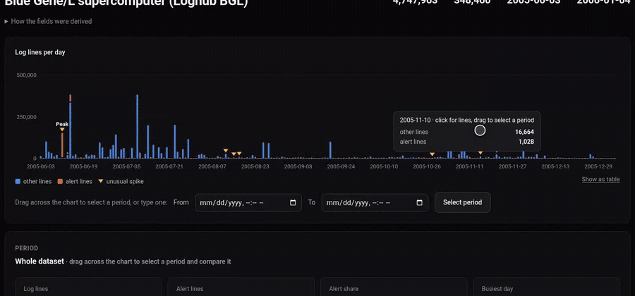

*Drag across the chart to pick a period: SereneDB compares it with the previous period of the same length, and the takeaways are written from the numbers, without AI.*

## One investigation, three perspectives

The question "What happened around the runtime panics at 14:03 on 2005-07-11?" produces one set of facts from SereneDB and three explanations of it. The evidence column on the right is identical in all three.

| Engineer: what failed, and what came first | Team lead: what keeps coming back |
|---|---|
| 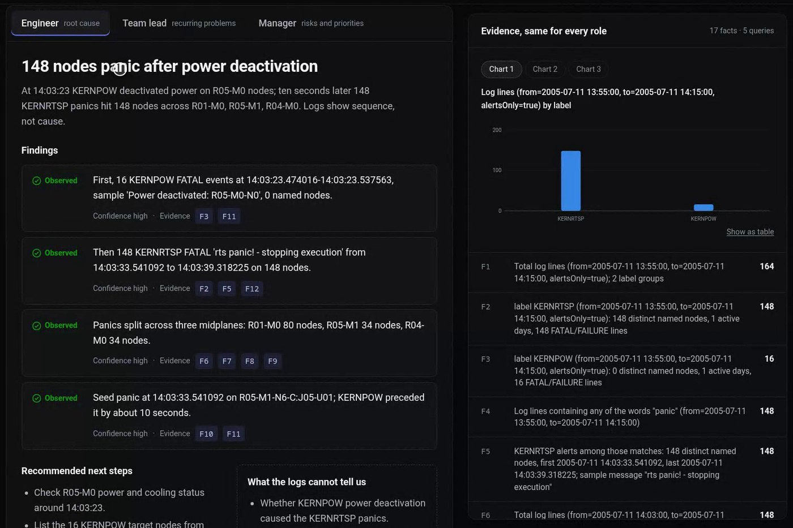 | 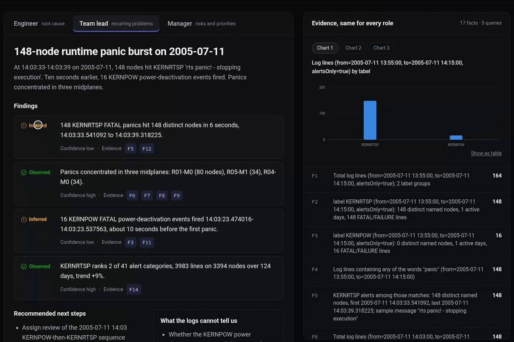 |
| A power-off on midplane R05-M0 at 14:03:23; ten seconds later 148 nodes panic on three other midplanes. The logs show the order, not the cause. | The same facts, framed as recurrence and concentration. A number the model writes that is not in the evidence is marked **inferred** by the server. |

| Manager: what to prioritise | Every claim opens its proof |
|---|---|
| 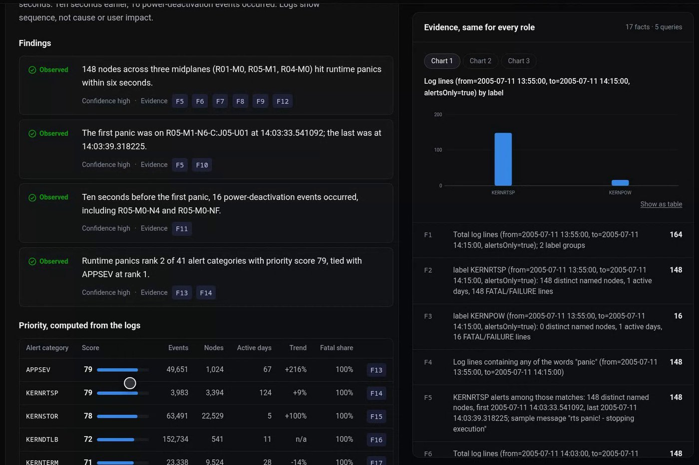 | 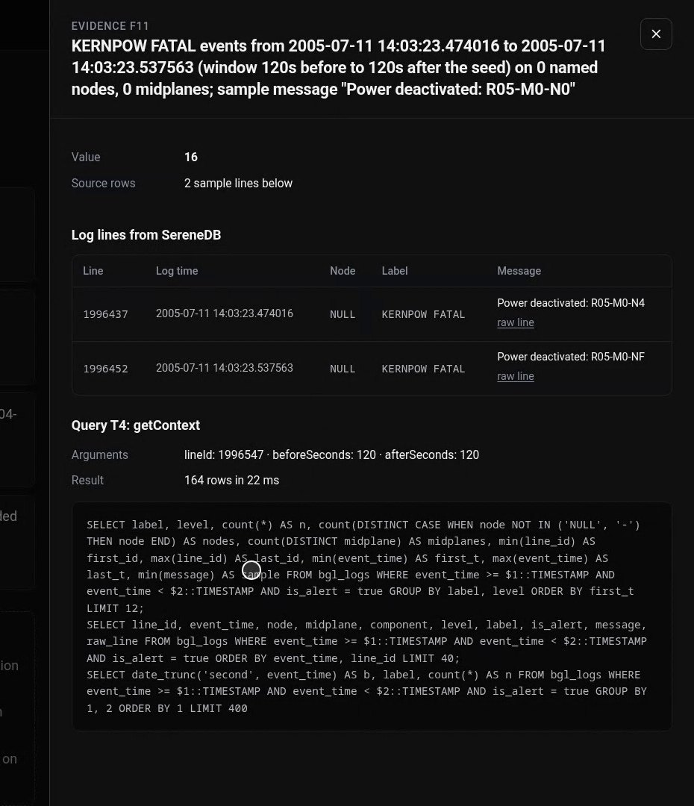 |
| Plain language and a priority score from a visible formula over database counts, not an AI guess. | Each fact id opens the source log lines and the exact SQL, with row count and time. |

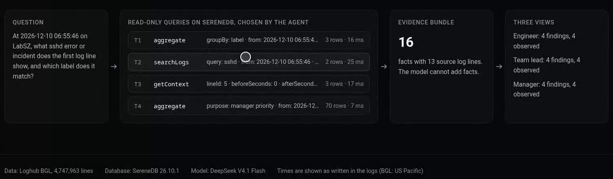

*"How this answer was built": the question, the read-only queries the agent chose (with row counts and milliseconds), the evidence bundle and the three views.*

## For non-experts, and for any log file

| SQL-only overview with key takeaways | Upload your own logs |
|---|---|
| 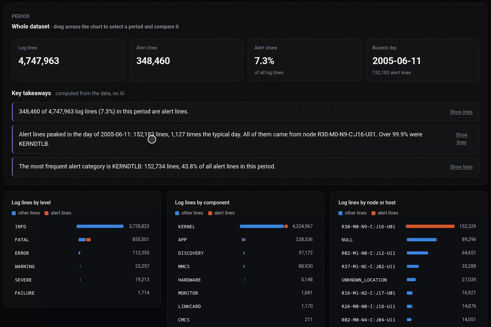 | 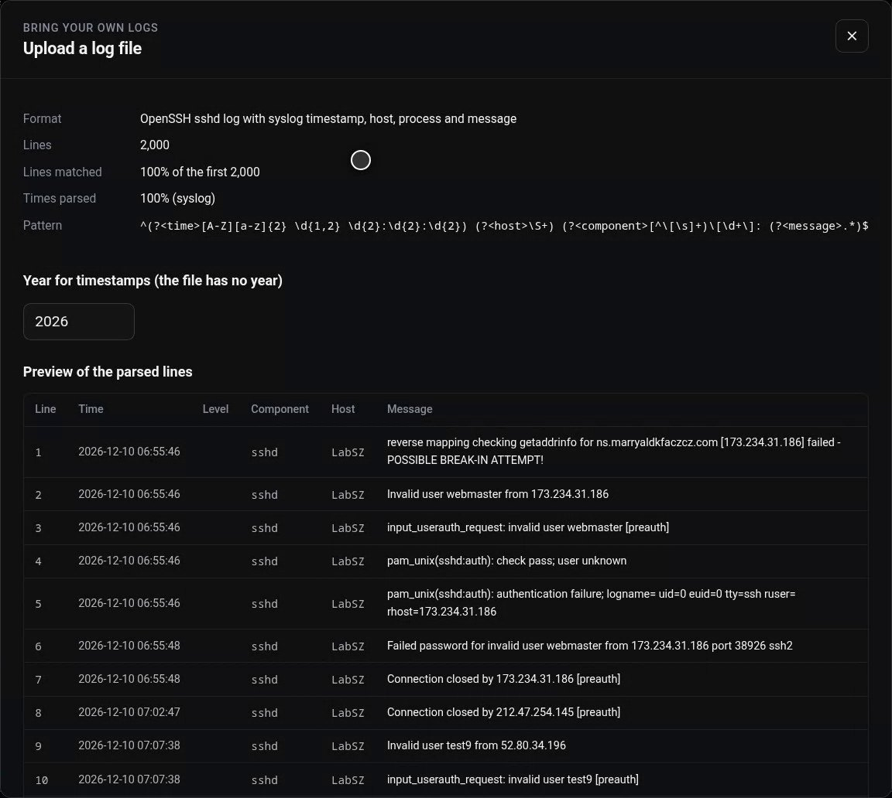 |
| KPI tiles and takeaways written by rules from SQL results, plus breakdowns by level, component and node. Click any bar or pattern for the raw lines. | The model proposes a parser from 40 lines; the server tests it on 2,000 lines before loading. Here an SSH server log it had never seen: 100% of lines matched. |

| What changed compared with the previous period | A dashboard for the uploaded file |
|---|---|
| 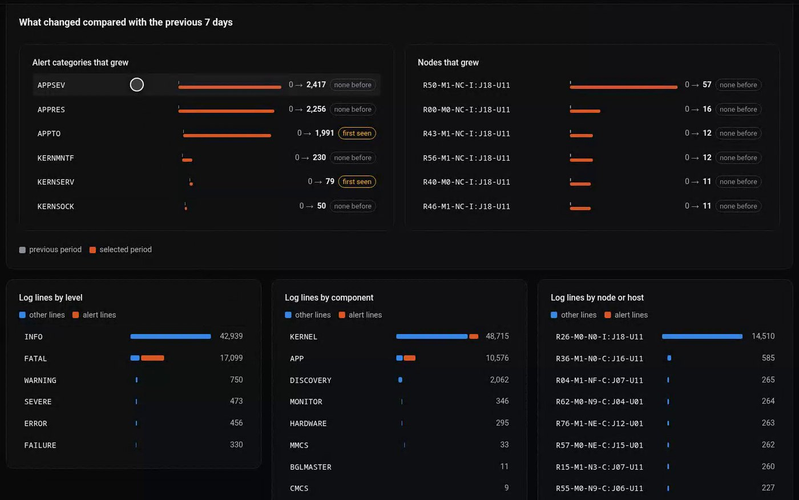 | 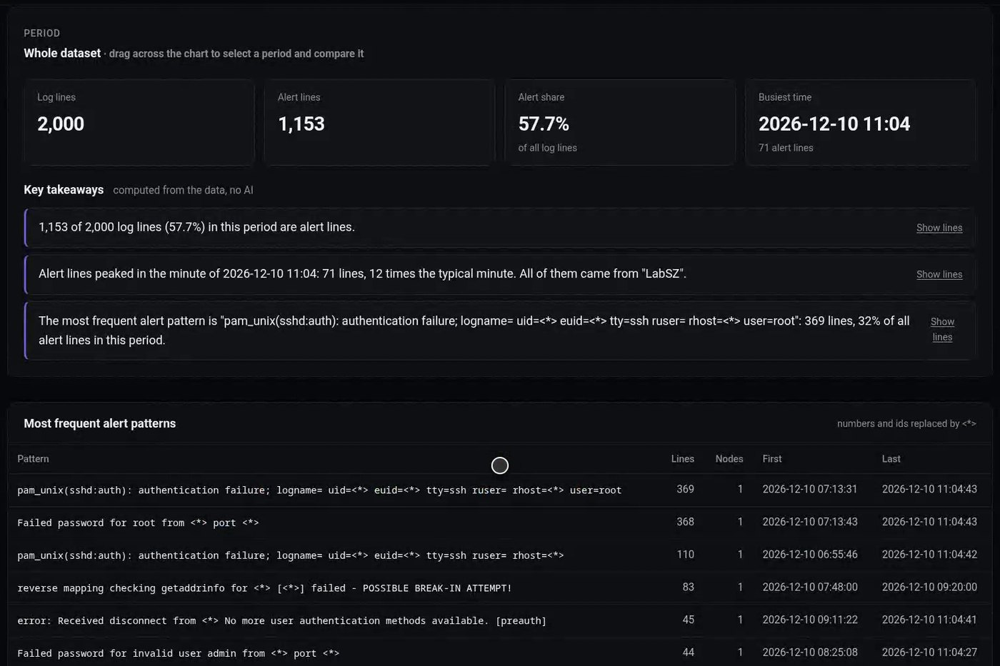 |
| Categories and nodes that grew, with "first seen" badges, each one click away from its lines. | The same overview, takeaways and three-role investigation work on the uploaded data. |

## How it works

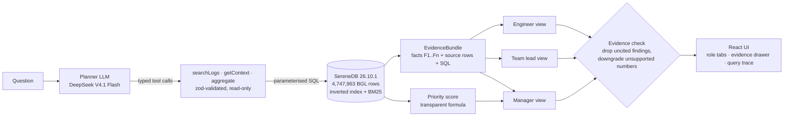

```
question
  -> planner LLM picks 2 to 6 typed, read-only tool calls (searchLogs, getContext, aggregate)
  -> SereneDB runs them on the full corpus (inverted index + BM25, SQL aggregation)
  -> server turns results into numbered facts (F1, F2, ...) with source line ids  = EvidenceBundle
  -> server computes a transparent manager priority score from database counts
  -> three role writers explain the SAME bundle; every finding must cite fact ids
  -> server drops findings without valid evidence and downgrades claims whose numbers are not in the cited facts
```

- The LLM never writes SQL and never invents facts. Tool arguments are validated (zod) and passed as SQL parameters.
- Switching roles changes the explanation, not the evidence.
- If BM25 scoring fails, search falls back to exact matching (`SEARCH_MODE=match` forces it); if the LLM fails, the evidence is still returned and the view shows the error.
- Manager priority: `score = 100 x (0.30 x events + 0.25 x nodes + 0.20 x activeDays + 0.15 x fatalShare + 0.10 x trend)`, each input scaled 0..1 against the largest alert category (events and nodes on a log scale). Trend compares the last quarter of the period with the quarter before.

## Bring your own logs

Upload any line-based log file (up to 50 MB) and get the same investigation on it:

1. The model sees the first 40 lines and writes a parsing pattern (named groups time, level, component, host, message) plus the timestamp format.
2. The server tests the pattern on the first 2,000 lines inside a worker thread with a time limit. Below 98% matched lines it asks again with the failing lines; with no usable pattern it falls back to whole lines. The user sees the match rate and a preview before anything is loaded.
3. Every line is loaded into its own SereneDB table and inverted index with the same columns as BGL, so all tools, evidence checks and role views work unchanged. Lines that do not match (for example stack traces) are kept and take the previous line's time.
4. Alert = level WARNING or worse, or an error keyword when a line has no level. Label = the alert line's message pattern with numbers and ids replaced by `<*>`, so repeats group together.
5. A dashboard computed by SereneDB alone (lines over time, levels, components, hosts, top alert patterns) opens right away; clicking any bar or pattern shows the raw lines and the SQL. The model also suggests one question per role.

Tested on six public Loghub samples in different formats (HDFS, Linux syslog, Apache, OpenSSH, Zookeeper, Spark): one detection run each on 2026-10-18 matched 100% of lines and parsed 100% of timestamps, in 4 to 9 s (Linux needed a second attempt). Loading 2,000 lines, indexing and suggesting questions took 6 to 7 s. Syslog timestamps have no year, so the upload screen asks for one.

Privacy: the 40-line sample, and later facts and sample lines, go to the language model provider. The upload screen says so; only upload logs you may share with an external AI service.

## Stack

| Part | Choice |
|---|---|
| Database | SereneDB 26.10.1 (Docker, amd64) |
| Ingest | Python 3 + pyarrow: BGL.log to Parquet, then `COPY ... (FORMAT parquet)` |
| Backend | Node.js 26 (runs TypeScript directly), Fastify, node-postgres, zod |
| LLM | DeepSeek V4.1 Flash via Synthetic (OpenAI-compatible API), tool calling + strict JSON schema |
| Frontend | React + TypeScript (Vite) |

## Run it

Requirements: Linux x86-64 with AVX2, Docker, Node.js 26, Python 3 with pyarrow, `psql`, and a Synthetic API key.

```bash
scripts/setup.sh                       # download BGL (md5 checked), parse, start SereneDB, load, index
cd backend && npm install
SYNTHETIC_API_KEY=... npm start        # http://127.0.0.1:8787, warms the example questions
cd ../frontend && npm install && npm run dev
scripts/smoke.sh                       # end-to-end checks against the running backend
```

API: `GET /api/health`, `GET /api/examples`, `GET /api/datasets`, `POST /api/datasets/detect` (text/plain body), `POST /api/datasets/:id/ingest`, `GET /api/datasets/:id/overview`, `GET /api/datasets/:id/lines`, `POST /api/investigate {"question": "..."}` (`?fresh=1` skips the answer cache) and `POST /api/investigate/stream?first=<role>`, which streams newline-delimited JSON events: each finished query, the evidence bundle, then each role view (the selected role first). The contract is in `shared/contract.ts`.

## Demo video

`demo/record.py` records each scene from the running app with Playwright (1080p, visible cursor, timestamped markers); `demo/build.py` speeds up the waiting parts (labelled on screen), adds title and end cards and burned-in English captions, and writes `demo/out/demo.mp4` (1920x1080, 30 fps, H.264, BT.709, silent audio track).

## Data

- Loghub BGL, Zenodo record 8196385, `BGL.zip` md5 `4452953c470f2d95fcb32d5f6e733f7a`, 4,747,963 lines, 348,460 alert lines in 41 categories.
- Every line becomes one row; nothing is dropped. 4,713,169 lines parse cleanly, 34,470 have an empty message, 306 have no node, 18 are wrapped continuation lines (`parse_status` column). `raw_line` keeps the original text.
- Times are shown as printed in the log (US Pacific wall time). The epoch column is UTC.
- Derived columns (ours, not in BGL): `line_id` (line number), `is_alert` (label is not `-`), `midplane` (first two parts of the node name), `parse_status`.

## Measured (local, one machine)

AMD Ryzen 7 7745HX laptop, 16 threads, 32 GB RAM, SereneDB 26.10.1 in Docker, 2026-10-18:

| Step | Time |
|---|---|
| Parse BGL.log to Parquet | 69 s |
| COPY 4,747,963 rows | 3.4 s |
| `CREATE INDEX ... USING inverted` returned | 2.3 s |
| Demo SQL queries (phrase search, BM25 top-k, time windows, GROUP BY over all alerts) | 1 to 12 ms each, two runs |
| Database time per investigation | 45 to 136 ms |
| LLM time per investigation | about 30 s: planner about 9 s, then three role views written one after another |
| Streamed: evidence on screen / first role view / all views | 9.4 s / 16.8 s / 29.7 s (one browser run) |

## SereneDB notes from building this (26.10.1, reproduced on 2026-10-18)

- BM25 ranking worked on the full 4.7M-row corpus; we saw no Unicode error. The source file is valid UTF-8 throughout.
- `SET statement_timeout` is accepted with the warning "not enforced by serened", so the 8 s query budget lives in the client (`query_timeout` in node-postgres).
- `GROUP BY` directly over the inverted index overcounted one group in our tests:
  `SELECT label, count(*) FROM bgl_idx WHERE message @@ 'panic' GROUP BY label` returns a `-` group with 2 rows, while `SELECT count(*) FROM bgl_idx WHERE message @@ 'panic' AND label = '-'` returns 0 and the plain `count(*)` (4,001) matches a regex scan of the base table and `grep` on the raw file. Our grouped queries therefore use the index only to select line ids (`WHERE line_id IN (SELECT line_id FROM bgl_idx WHERE ...)`) and group on the base table, which returns exact counts in 4 to 8 ms.

## What the logs cannot tell you

BGL has no ownership, customer, cost, downtime or SLA data. The agent says so instead of guessing, and marks anything beyond the facts as "inferred".

## Declaration

- Dataset: Loghub BGL (logpai/loghub, Zenodo 8196385), used as published.
- Pre-existing components: SereneDB, Fastify, node-postgres, zod, pyarrow, React, Vite and their licences.
- AI tools: DeepSeek V4.1 Flash (via Synthetic) is the runtime model. Claude (Anthropic) and ChatGPT were used as coding and research assistants during the event.
- All code in this repository was written during the event.
